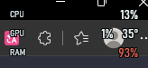

# HardwareHud · 硬件实时监测悬浮窗

一个常驻桌面的极小硬件仪表盘：CPU / GPU / 内存的使用率与历史曲线，外加 GPU 温度、功耗、频率、风扇，以及磁盘与网络的实时吞吐。

纯 **.NET Framework 4.8 + WPF**，无任何第三方依赖、无需安装、单文件 exe（约 75 KB）。

| 面板模式 | 极简模式 |
| --- | --- |
|  |  |

托盘图标（任务栏 `^` 右侧）：


---

## 快速开始

桌面已有快捷方式 **`硬件监测`**，双击即可。它指向的是安装目录：

```
%LOCALAPPDATA%\Programs\HardwareHud\HardwareHud.exe
```

即 `C:\Users\<你>\AppData\Local\Programs\HardwareHud\`，不需要管理员权限，卸载时删掉这个目录和桌面快捷方式即可。

> **不要直接运行 `F:\agent study\hardware-hud\dist\HardwareHud.exe`。**
> 这台机器上，从工作区路径（`F:\agent study\...`）启动的进程会被拦掉两件事：通知区域图标注册失败（`tray=fail(size=976,err=0)`），`%APPDATA%` 也不可写（配置只能退化存到 exe 旁边）。同一个 exe 放到 C 盘任何位置都正常（`tray=ok`，配置写 `%APPDATA%\HardwareHud\`）。`dist\` 只是构建产物，`build.bat` 编完会自动覆盖到安装目录。

也可以直接运行安装目录里的 exe：

```
"%LOCALAPPDATA%\Programs\HardwareHud\HardwareHud.exe"
```

窗口默认出现在屏幕右上角，**左键拖动可移动**，**右键打开菜单**，同时也出现在**任务栏**和**通知区域**。

菜单项：

| 菜单 | 说明 |
| --- | --- |
| 极简模式 | 只显示 CPU / GPU / 内存 三行文字，不画面板与曲线（勾上即为开启） |
| 始终置顶 | 是否压在其他窗口之上 |
| 不透明度 | 循环切换 100 / 90 / … / 70 % |
| 回到右上角 | 复位到默认位置 |
| 开机自启动 | 写入 `Startup\HardwareHud.vbs`（静默启动） |
| 桌面快捷方式 | 在桌面创建或修复 `硬件监测.lnk` |
| 诊断信息 | 弹出一个框列出 exe 路径、构建时间、托盘 / 热键 / 系统菜单 / 任务栏的注册状态和日志路径，看不到托盘图标时用它取证 |
| 重新添加托盘图标 | 只在托盘图标注册失败时才出现，点一下会重试并告诉你具体原因 |
| 退出 | 保存位置后退出 |

位置、置顶、不透明度、极简模式、自启动状态保存在 `%APPDATA%\HardwareHud\settings.ini`，下次启动自动恢复。
如果该目录不可写（受限用户配置 / 受管企业环境），会依次退到 `%LOCALAPPDATA%\HardwareHud`、再退到 exe 同目录下的 `HardwareHud\`，不会因为一处写失败就丢掉全部设置。

开机自启动同理有两条路：默认写 `启动\HardwareHud.vbs`（静默、不闪黑窗口）；写不进去时自动退到注册表 `HKCU\...\CurrentVersion\Run`。

单实例运行（重复启动会直接退出）。替换成新版本 exe 后，记得先用菜单「退出」关掉正在运行的那个实例 —— 老进程不会自动获得新功能。

**找不到窗口时**：再双击一次桌面快捷方式就行 —— 第二个实例不会真的启动，而是把已经在跑的那个叫到最前面并直接弹出配置菜单。极简模式下窗口只有一小块文字，这是最省事的唤起方式。

每次启动和退出都会在配置目录（通常是 `%APPDATA%\HardwareHud\`）写一行 `HardwareHud.log`，记录 exe 路径、构建时间、托盘 / 热键 / 系统菜单 / 任务栏的注册结果和窗口位置。超过 64 KB 自动清空。

---

## 随时找到它：任务栏、托盘与热键

极简模式下窗口只有一小块文字，所以除了「右键窗口」，还有四条随时可用入口：

| 入口 | 操作 | 能得到什么 |
| --- | --- | --- |
| 任务栏按钮 | 点击 | 让窗口获得焦点（之后可 `Alt+Space` 或直接右键窗口） |
| 系统菜单 | 窗口有焦点时按 `Alt+Space` | 原生菜单，内容与右键菜单完全一致 |
| 通知区域图标 | 双击 / 右键 | 双击切极简；右键弹出完整菜单；鼠标停留显示当前 CPU / GPU / 内存数值 |
| 快捷键 `Ctrl+Alt+H` | 任意位置按下 | 立刻切换极简模式 |

程序会把 `WS_EX_APPWINDOW` 强制打开（WPF 的 `ShowInTaskbar` 对无边框透明窗口不够用），所以任务栏一定有它的按钮；系统菜单用 `WS_SYSMENU` + `SetWindowPos(SWP_FRAMECHANGED)` 补出来 —— 无边框窗口默认是没有系统菜单的。

**托盘图标在 Windows 11 上默认被收进 `^`「隐藏的图标」里**，这是系统的行为，不是程序没加上。想让它常驻任务栏：

- 点任务栏右下角的 `^`，找到「硬件监测」，在「任务栏设置 → 其他系统托盘图标」里把它改成「在任务栏上显示」；
- 或者 设置 → 个性化 → 任务栏 → 其他系统托盘图标 → 打开「硬件监测」开关。

程序自己也会做一步：图标第一次注册成功后，Windows 会立刻在 `HKCU\Control Panel\NotifyIconSettings` 下为它建一条记录，程序随即把这条记录标成 `IsPromoted=1`，于是图标直接出现在任务栏上（通常当场生效，最迟下次启动）。你如果手动改成了「隐藏」，程序就不会再覆盖你的选择。

Explorer 重启（崩溃、切换显示设置等）会清空托盘，程序收到系统的 `TaskbarCreated` 广播后会自动把图标加回去；登录早期托盘尚未就绪时，会每 2 秒重试，最多 8 次。

托盘图标即使注册失败（某些受限桌面会拒绝 `Shell_NotifyIcon`），任务栏、系统菜单和热键这三条路依然有效；此时菜单里会多出一行「重新添加托盘图标」，点它能看到具体的失败原因。

---

## 界面

```
┌────────────────────────────────────────┐
│ HARDWARE·HUD            i5-12600KF     │   ← 标题 + CPU 型号
│ ────────────────────────────────────── │
│ 处理器              ▃▅▂▇▃▅ 46 %        │   ← 大数字 + 112 点历史曲线
│ 10 核 16 线程                          │   ← 补充信息行
│                                        │
│ 显卡                ▁▂▃▂▅▃▂▁ 24 %        │
│ 1.7 / 8.0 GB  37°C  功耗 N/A  465 MHz   │
│                                        │
│ 内存                ▇▇▇▇▇▇▇▇ 81 %        │
│ 12.8 / 15.8 GB                         │
│ ────────────────────────────────────── │
│ 磁盘 ↓ 2.1 MB/s       网络 ↓ 8.4 KB/s   │
│ 磁盘 ↑ 0.3 MB/s       网络 ↑ 1.2 KB/s   │
└────────────────────────────────────────┘
```

- 每行一条 112 点的滑动历史（500 ms 采样 → 约 56 秒窗口）。
- 三行配色：CPU 琥珀 `#E3A551`、GPU 青 `#52B4C4`、内存 灰蓝 `#95A9B0`。
- 支持多 GPU：检测到多块 NVIDIA 卡时，显卡行会自动按 `显卡 1 / 显卡 2` 展开。

---

## 极简模式

右键菜单 → **极简模式**（或双击托盘图标、或按 `Ctrl+Alt+H`）。打开后整个面板（底色、边框、投影、网格、曲线、标题与页脚）全部消失，
右上角只剩三行文字，窗口从 400×397 缩到 **164×75**：

```
CPU            28%
GPU   24%  47°
RAM            83%
```

- 每行只有「指标名 + 数值」，GPU 行在能读到温度时再跟一个 `47°`。
- 文字带 **1px 八方向深色描边**，压在白色或花哨壁纸上也读得清，不依赖任何底图。
- 数值 ≥ 90% 时数字转为警示红 `#E6624F`（和面板模式同一套规则）。
- 依然可以左键拖动、右键打开菜单；切换时以右边缘为锚，不会从右上角跳走。
- 开关状态写入 `settings.ini` 的 `minimal=1`，重启后保持。
- 画布做了整块命中测试，点在文字之间的空白处也不会「穿透」到桌面。

> 忘了怎么退出极简模式时：双击托盘图标、按 `Ctrl+Alt+H`、或让窗口获得焦点后按 `Alt+Space` → 「极简模式」。

> 极简模式只保留三项最必要的指标，磁盘与网络吞吐不在其中。

---

## 数据来源

| 指标 | 来源 |
| --- | --- |
| CPU 使用率 | `GetSystemTimes`（内核态 + 空闲时间差），采样线程 500 ms |
| CPU 频率 | 性能计数器 `Processor Information\% Processor Performance` × 注册表 `~MHz` 基准 |
| CPU 核心 / 线程 | `GetLogicalProcessorInformationEx(RelationProcessorCore)` |
| 内存总量 / 可用 | `GlobalMemoryStatusEx` |
| 内存已提交 | 性能计数器 `Memory\Committed Bytes` |
| GPU 全部指标 | **NVML 直连** `nvml.dll`（利用率、显存、温度、功耗、风扇、核心频率） |
| 磁盘吞吐 | 性能计数器 `PhysicalDisk(*)\Disk Read|Write Bytes/sec`（实例 `_Total`） |
| 网络吞吐 | 性能计数器 `Network Interface\Bytes Received|Sent/sec`（自动过滤 isatap / Teredo / Loopback / Pseudo） |

**关于 NVML 直连**：不像常见做法那样每次 `spawn nvidia-smi.exe` 再解析文本，这里在进程内一次性 `nvmlInit_v2`，之后按需调用 `nvmlDeviceGet*`。开销从「每轮几十毫秒 + 一个子进程」降到「微秒级函数调用」。

**任何一项指标拿不到都不会让程序出错**，只会以 `N/A` / 空白显示：

- RTX 4060 笔记本 / 桌面版的 `nvmlDeviceGetPowerUsage` 在本机返回 `rc=3`（不支持），功耗位显示 `功耗 N/A`，其余指标照常。
- 没有 NVIDIA 显卡时，显卡行显示「未检测到 NVIDIA 驱动」，CPU 与内存仍正常工作。
- 没有 CPU 温度传感器（`MSAcpi_ThermalZoneTemperature` 返回 0 个实例的机器）时，不显示 CPU 温度。

---

## 从源码构建

无需 Visual Studio、无需 .NET SDK，只用 Windows 自带的 .NET Framework 编译器：

```
build.bat
```

输出 `dist\HardwareHud.exe`。脚本内部就是一行 `csc.exe`：

```
C:\Windows\Microsoft.NET\Framework64\v4.0.30319\csc.exe
  /target:winexe /optimize+ /out:dist\HardwareHud.exe
  /win32icon:assets\HardwareHud.ico
  /r:System.dll /r:System.Core.dll /r:System.Xaml.dll
  /r:...\WPF\WindowsBase.dll /r:...\WPF\PresentationCore.dll
  /r:...\WPF\PresentationFramework.dll
  src\HardwareHud.cs
```

唯一的源文件是 `src\HardwareHud.cs`（约 2400 行，C# 5 语法，因为自带的 csc 只支持到 C# 5）。

> 重新编译前请先退出正在运行的实例，否则 `csc` 会因为文件被占用而报 `CS0016`。

---

## 开发期诊断开关

程序内置了一套「不经过屏幕抓取」的自检手段，用于精确验证渲染结果：

```
HardwareHud.exe --snapshot out.png --scale 2 --wait 5000
```

| 参数 | 作用 |
| --- | --- |
| `--snapshot <png>` | 把面板用 `RenderTargetBitmap` 渲染成 PNG 后退出 |
| `--scale <n>` | 渲染倍率（默认 2） |
| `--wait <ms>` | 采样多久后再截图（默认 2500；设为 60000 可拿到满历史） |
| `--geometry <txt>` | 额外输出窗口 / 画布的实际几何，以及 `tray=` / `hotkey=` / `sysmenu=` / `taskbar=` / `tip=` 五条注册状态 |
| `--shortcut` | 在桌面创建 / 修复快捷方式后退出，结果写入 exe 同目录的 `shortcut-result.txt` |
| `--minimal` | 本次进程强制以极简模式启动（不写回配置） |
| `--toggle` | 启动后再切换一次模式，用来验证两种模式之间的互相切换 |

同时会在 PNG 旁边写出 `out.png.layout.txt`：逐行的 label / 数字 / 单位 / 曲线窗口 / 说明行的精确包围盒，外加自动检查的 **文字是否重叠、是否越界、是否溢出可用宽度、序列点数与极值**。所有检查项应全部为 `no` / `ok`。

```
$ .\dist\HardwareHud.exe --snapshot shot.png --wait 60000
$ .\.build\CurveCheck.exe shot.png 34 154 628 64   # 验曲线：40 列每列取值 + 有无曲线
```

---

## 目录结构

```
hardware-hud/
├─ src/HardwareHud.cs      唯一源文件（采集 / 视觉 / 窗口 / 菜单 / 托盘）
├─ assets/HardwareHud.ico  多尺寸图标（16…256，构建时嵌入 exe）
├─ build.bat               一行 csc 构建脚本（ASCII + CRLF）
├─ dist/HardwareHud.exe    产物
├─ tools/capture.ps1       整屏截图（早期手工核对用）
└─ .build/                 开发期像素分析工具（csc 独立编译，可整目录删除）
   ├─ CurveCheck.exe       曲线可见性 / 高度校验
   ├─ Blues.exe            低饱和（内存）曲线校验
   ├─ Grab.exe             按窗口句柄抓屏
   ├─ MkIcon.exe           生成多尺寸 ICO
   ├─ PixProbe.exe         采样列饱和度
   ├─ ColDump.exe          单列逐像素 RGB
   ├─ CellAudit.exe        分格统计彩色像素
   ├─ CoreProbe.exe        枚举 GetLogicalProcessorInformationEx
   ├─ Fx.exe / Fx2.exe     WPF 绘制原语的隔离对照组
   └─ Ascii / Ink / Bands / Pix / Audit / WellDump   早期 ASCII 降采样工具
```

安装方式：把桌面快捷方式 `硬件监测` 指向 `dist\HardwareHud.exe` 即可（图标已嵌入 exe，快捷方式直接用 `,0`）。

---

## 已知限制

- **仅 Windows**。WPF + Win32 互操作，没有跨平台打算。
- **GPU 只支持 NVIDIA**（走 NVML）。AMD / Intel 核显目前不会出现在显卡行。
- 采样 500 ms、历史 112 点，也就是固定约 56 秒窗口；没有做可配置。
- 极简模式与面板模式共用同一份采样和同一套阈值，但极简模式只显示 CPU / GPU / 内存三项。
- 通知区域图标需要系统托盘可用；被组策略或受限桌面拒绝时会静默跳过（其余入口不受影响）。
- `--snapshot` 等开关属于开发设施，保留在发布版本里但不影响正常使用。
