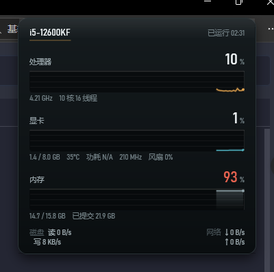

# HardwareHud · 硬件实时监测悬浮窗

一个常驻桌面的极小硬件仪表盘：CPU / GPU / 内存的使用率与历史曲线，外加 GPU 温度、功耗、频率、风扇，以及磁盘与网络的实时吞吐。

纯 **.NET Framework 4.0+ + WPF**（开发与测试在 4.8 上进行），无任何第三方依赖、无需安装、单文件 exe（约 95 KB）。

可运行在 **Windows 7 SP1 / 8.1 / 10 / 11**：只用了 .NET Framework 4.0 就存在的 API，没有碰 `VisualTreeHelper.GetDpi`（4.6.2+）、`RuntimeInformation`（4.7.1+）、`AppContext`、`Task.Delay` 这类新 API；所有 P/Invoke 都按「缺 DLL 就退下一级」处理。

| 面板模式 | 极简模式 |
| --- | --- |
|  |  |

托盘图标（任务栏 `^` 右侧）：


---

## 快速开始

程序是**绿色单文件**，没有安装包、不写注册表服务、不需要管理员权限。

1. 拿到 `HardwareHud.exe`：自己构建（见[从源码构建](#从源码构建)），或从 Releases 页面下载（如果发布了自己的构建）。
2. 把它放到一个固定目录，推荐 `%LOCALAPPDATA%\Programs\HardwareHud\`：

   ```
   %LOCALAPPDATA%\Programs\HardwareHud\HardwareHud.exe
   ```

3. 双击运行。首次启动后，右键菜单里点一次 **桌面快捷方式**（建 `硬件监测.lnk`）和 **开机自启动**（建启动项），之后就可以从桌面或开机直接用了。

**卸载**：右键菜单 → 退出；先在菜单里取消「开机自启动」，再删掉上面那个目录和桌面快捷方式即可，没有残留。

> **为什么不建议直接从 `dist\` 里运行？**
> `dist\HardwareHud.exe` 只是构建产物。从某些位置（例如网络驱动器、映射盘、受控的工作区目录）启动的进程会被系统限制：通知区域图标注册失败、`%APPDATA%` 不可写（配置只能退化存到 exe 旁边）、连「桌面快捷方式 / 开机自启动 `.lnk`」的 `Save` 也可能被拒（`UnauthorizedAccessException`）。同一个 exe 放到 `%LOCALAPPDATA%` 下就一切正常。`build.bat` 编完会自动把新版本覆盖到安装目录，所以日常用安装目录那份就好。

窗口默认出现在屏幕右上角，**左键拖动可移动**，**右键打开菜单**，平时只在**通知区域**里留一个图标，不占任务栏位置（想让它出现在任务栏，勾上菜单里的「在任务栏显示」）。

菜单项：

| 菜单 | 说明 |
| --- | --- |
| 极简模式 | 只显示 CPU / GPU / 内存 三行文字，不画面板与曲线（勾上即为开启） |
| 在任务栏显示 | 是否在任务栏留一个按钮。默认关闭，只在托盘里显示；关闭后 `Alt+Tab` 里也看不到它 |
| 始终置顶 | 是否压在其他窗口之上 |
| 不透明度 | 循环切换 100 / 90 / … / 70 % |
| 回到右上角 | 复位到默认位置 |
| 开机自启动 | 在「启动」文件夹写 `HardwareHud.lnk`（静默启动）；失败时退回注册表 `HKCU\...\Run` |
| 桌面快捷方式 | 在桌面创建或修复 `硬件监测.lnk` |
| 诊断信息 | 弹出一个框列出 exe 路径、构建时间、托盘 / 热键 / 系统菜单 / 任务栏的注册状态和日志路径，看不到托盘图标时用它取证 |
| 重新添加托盘图标 | 只在托盘图标注册失败时才出现，点一下会重试并告诉你具体原因 |
| 退出 | 保存位置后退出 |

位置、置顶、不透明度、极简模式、自启动状态保存在 `%APPDATA%\HardwareHud\settings.ini`，下次启动自动恢复。
如果该目录不可写（受限用户配置 / 受管企业环境 / 只读共享），会依次退到 `%LOCALAPPDATA%\HardwareHud`、再退到 exe 同目录下的 `HardwareHud\`；运行中保存失败也会当场换目录重试，不会因为一处写失败就丢掉全部设置。配置行按「第一个 `=`」切分，值里带 `=`（比如路径）也不会被整行丢掉。

开机自启动默认在「启动」文件夹放一个 `HardwareHud.lnk`（指向当前 exe，静默启动、不闪黑窗口），老版本留下的 `HardwareHud.vbs` 会被顺手删掉；快捷方式建不出来时退回注册表 `HKCU\...\CurrentVersion\Run`。三种形式任意一种存在，菜单里就显示为已开启，点一下能全部关掉并清理干净。

单实例运行（重复启动会直接退出）。替换成新版本 exe 后，记得先用菜单「退出」关掉正在运行的那个实例 —— 老进程不会自动获得新功能。

**找不到窗口时**：再双击一次桌面快捷方式就行 —— 第二个实例不会真的启动，而是把已经在跑的那个叫到最前面并直接弹出配置菜单。极简模式下窗口只有一小块文字，这是最省事的唤起方式。

每次启动和退出都会在配置目录（通常是 `%APPDATA%\HardwareHud\`）写一行 `HardwareHud.log`，记录 exe 路径、构建时间、托盘 / 热键 / 系统菜单 / 任务栏的注册结果、窗口位置、`pdh=`（磁盘/网络计数器状态）和 `gpu=`（NVML 认到的卡数，`none` 表示走 DXGI + PDH 兜底）以及 `render tier=`（WPF 渲染层级）。采样线程、UI 线程、后台任务的意外异常也都落在这里（`sampler:` / `dispatcher-ex` / `unhandled` / `fatal` / `settings: fallback to`），不会再有「窗口突然消失、日志里什么都没有」的情况。超过 64 KB 自动清空。

---

## 随时找到它：托盘、系统菜单与热键

窗口默认**不在任务栏占位置**，只在通知区域（托盘）留一个图标 —— 桌面底部那条任务栏和 `Alt+Tab` 里都不会出现它。想要任务栏按钮，可以在右键菜单里勾上「在任务栏显示」。

极简模式下窗口只有一小块文字，所以除了「右键窗口」，还有这几条随时可用入口：

| 入口 | 操作 | 能得到什么 |
| --- | --- | --- |
| 通知区域图标 | 双击 / 右键 | 双击切极简；右键弹出完整菜单；鼠标停留显示当前 CPU / GPU / 内存数值 |
| 系统菜单 | 窗口有焦点时按 `Alt+Space` | 原生菜单，内容与右键菜单完全一致 |
| 快捷键 `Ctrl+Alt+H` | 任意位置按下 | 立刻切换极简模式 |
| 任务栏按钮 | 点击（需先开启） | 让窗口获得焦点（之后可 `Alt+Space` 或直接右键窗口） |

任务栏按钮默认是关的：无边框透明窗口在 WPF 里要手动改扩展样式，程序默认给窗口打 `WS_EX_TOOLWINDOW`（没有任务栏按钮、不参与 `Alt+Tab`），勾上「在任务栏显示」后改打 `WS_EX_APPWINDOW`。系统菜单则用 `WS_SYSMENU` + `SetWindowPos(SWP_FRAMECHANGED)` 补出来 —— 无边框窗口默认是没有系统菜单的。

**托盘图标在 Windows 11 上默认被收进 `^`「隐藏的图标」里**，这是系统的行为，不是程序没加上。想让它常驻任务栏：

- 点任务栏右下角的 `^`，找到「硬件监测」，在「任务栏设置 → 其他系统托盘图标」里把它改成「在任务栏上显示」；
- 或者 设置 → 个性化 → 任务栏 → 其他系统托盘图标 → 打开「硬件监测」开关。

程序自己也会做一步：图标第一次注册成功后，Windows 会立刻在 `HKCU\Control Panel\NotifyIconSettings` 下为它建一条记录，程序随即把这条记录标成 `IsPromoted=1`，于是图标直接出现在任务栏上（通常当场生效，最迟下次启动）。你如果手动改成了「隐藏」，程序就不会再覆盖你的选择。

Explorer 重启（崩溃、切换显示设置等）会清空托盘，程序收到系统的 `TaskbarCreated` 广播后会自动把图标加回去；登录早期托盘尚未就绪时，会每 2 秒重试，最多 20 次（约 40 秒）—— 开机自启时 Explorer 常常比程序晚十几秒才起来，8 次远远不够。

托盘图标即使注册失败（某些受限桌面会拒绝 `Shell_NotifyIcon`），程序会先重试，20 次都不成功就**自动把任务栏按钮打开**（只在本次运行有效，不写进设置），免得关了任务栏之后一个入口都不剩；此时菜单里也会多出一行「重新添加托盘图标」，点它能看到具体的失败原因。

---

## 界面

```
┌──────────────────────────────────────────────┐
│ i5-12600KF                      已运行 10:42 │  ← CPU 型号（已精简）+ 运行时间
│ ──────────────────────────────────────────── │
│ 处理器                      ▃▅▂▇▃▅      46 % │  ← 大数字 + 112 点历史曲线
│ 4.31 GHz    10 核 16 线程                    │  ← 补充信息行
│                                              │
│ 显卡 NVIDIA GeForce RTX 4060     ▁▂▃▂▅  24 % │  ← 标签后面直接跟型号
│ 1.7 / 8.0 GB    37°C    功耗 N/A    465 MHz  │
│                                              │
│ 内存                      ▇▇▇▇▇▇▇▇      81 % │
│ 12.8 / 15.8 GB    已提交 20.4 GB             │
│ ──────────────────────────────────────────── │
│ 磁盘 读 2.1 MB/s             网络 ↓ 8.4 KB/s │
│      写 0.3 MB/s                  ↑ 1.2 KB/s │
└──────────────────────────────────────────────┘
```

- 每行一条 112 点的滑动历史（500 ms 采样 → 约 56 秒窗口）。
- 三行配色：CPU 琥珀 `#E3A551`、GPU 青 `#52B4C4`、内存 灰蓝 `#95A9B0`。
- 支持多 GPU：检测到多块卡时，显卡行会自动按 `显卡 1 / 显卡 2` 展开。
- 显卡行的标签后面直接跟随型号（如 `显卡 NVIDIA GeForce RTX 4060  24 %`），空间不够时按可用宽度截断成省略号，不会压到右侧的大数字。
- 标题栏的 CPU 型号做过精简：`12th Gen Intel(R) Core(TM) i5-12600KF` → `i5-12600KF`，`AMD Ryzen 9 7950X3D 16-Core Processor` → `AMD Ryzen 9 7950X3D`，`Intel(R) Xeon(R) Silver 4214R CPU @ 2.40GHz` → `Intel Xeon Silver 4214R`；型号太长时自动省略，避免和右上角的运行时间重叠。

---

## 极简模式

右键菜单 → **极简模式**（或双击托盘图标、或按 `Ctrl+Alt+H`）。打开后整个面板（底色、边框、投影、网格、曲线、标题与页脚）全部消失，只剩三行文字，窗口从 400×397 缩到 **164×75**：

```
CPU            15%
GPU   38%  38°
RAM            74%
```

- 每行只有「指标名 + 数值」，GPU 行在能读到温度时再跟一个 `38°`。
- 文字带 **1px 八方向深色描边**，压在白色或花哨壁纸上也读得清，不依赖任何底图。
- 数值 ≥ 90% 时数字转为警示红 `#E6624F`（和面板模式同一套规则）。
- 依然可以左键拖动、右键打开菜单；切换时以右边缘为锚，不会从右上角跳走。
- 开关状态写入 `settings.ini` 的 `minimal=1`，重启后保持。
- 画布做了整块命中测试，点在文字之间的空白处也不会「穿透」到桌面。

> 忘了怎么退出极简模式时：双击托盘图标、按 `Ctrl+Alt+H`、或让窗口获得焦点后按 `Alt+Space` → 「极简模式」。

> 极简模式只保留三项最必要的指标，磁盘与网络吞吐不在其中。

---

## 数据来源

| 指标 | 来源 |
| --- | --- |
| CPU 使用率 | `GetSystemTimes`（内核态 + 空闲时间差），采样线程 500 ms |
| CPU 频率 | PDH `\Processor Information(_Total)\% Processor Performance` × 注册表 `~MHz` 基准（基准读不到时用 PDH `Processor Frequency`） |
| CPU 核心 / 线程 | `GetLogicalProcessorInformationEx(RelationProcessorCore)` |
| 内存总量 / 可用 | `GlobalMemoryStatusEx` |
| 内存已提交 | PDH `\Memory\Committed Bytes` |
| GPU 型号 | **DXGI** `CreateDXGIFactory1` + `IDXGIFactory1.EnumAdapters1`（不限厂商；同一块卡被多个虚拟显示器枚举成多条时按「型号 + 厂商 + 显存」去重，虚拟显示适配器与 `Microsoft Basic Render Driver` 会被过滤掉） |
| GPU 利用率 / 显存占用 | 优先 **NVML** `nvmlDeviceGetUtilizationRates` / `nvmlDeviceGetMemoryInfo`；拿不到时（A 卡、核显、驱动没装）退 PDH `\GPU Engine(*)\Utilization Percentage` 与 `\GPU Adapter Memory(*)\Dedicated Usage` |
| GPU 温度·功耗·风扇·频率 | **NVML 直连** `nvml.dll`（仅 NVIDIA；这几项 PDH 拿不到） |
| 磁盘吞吐 | PDH `\PhysicalDisk(_Total)\Disk Read Bytes/sec` / `Disk Write Bytes/sec` |
| 网络吞吐 | PDH `\Network Interface(*)\Bytes Received/sec` / `Bytes Sent/sec`（通配枚举所有实例后过滤 isatap / Teredo / Loopback / Pseudo） |

**关于 PDH（性能数据助手）英文计数器**：老做法用 `System.Diagnostics.PerformanceCounter`，它必须用「系统显示语言」下的计数器名（中文系统是 `物理磁盘`，德文系统又是另一套），在非英文 Windows 上很容易直接抛 `InvalidOperationException`，而且原来这四项挂在同一个 `try` 里 —— 一项失败，磁盘、网络、已提交内存、CPU 频率全部变成 `N/A`。现在统一走 `PdhAddEnglishCounterW`：名字永远是英文，任何语言的 Windows 都能解析；所有计数器挂在同一个查询上，一次 `PdhCollectQueryData` 刷新全部；网络实例名用 `(*)` 通配枚举，不再依赖本地化的类别名。PDH 完全不可用的系统（极少数精简掉 PDH 的机器）只是这几项显示 `N/A`，CPU / GPU / 内存照常。

**关于 NVML 直连**：不像常见做法那样每次 `spawn nvidia-smi.exe` 再解析文本，这里在进程内一次性 `nvmlInit_v2`，之后按需调用 `nvmlDeviceGet*`。开销从「每轮几十毫秒 + 一个子进程」降到「微秒级函数调用」。

初始化也不再是「一次定生死」：开机自启时显卡驱动常常比程序晚就绪，NVML 会每 12 秒重试一次；跑起来之后每 30 秒核对一次设备数，驱动重启、显卡热插拔、eGPU 接入导致的卡数变化会自动跟上，显卡行也会跟着重排（不会一直停在 `--`）。

**关于 DXGI 与 PDH 的显卡兜底**：型号来自 DXGI（任何厂商都有），所以 A 卡 / 核显机器也能看到显卡型号。实时指标上，NVIDIA 走 NVML（利用率、显存、温度、功耗、风扇、频率全都齐），其它卡退到 PDH 的 `\GPU Engine(*)\Utilization Percentage` 和 `\GPU Adapter Memory(*)\Dedicated Usage` —— 只补利用率和显存占用，温度 / 功耗 / 风扇 / 频率这几项 PDH 没有对应计数器，会留空。这两项 PDH 计数器是 Win10 1709 才加的，更老的系统上显卡行只剩型号。GPU Engine 计数器会枚举出几百个实例（每个进程 × 每个引擎 × 每块卡各一条），所以它跑在一个**独立的 PDH 查询**里，只在 NVML 拿不到指标时才采集，NVML 齐全时一次都不碰。

**任何一项指标拿不到都不会让程序出错**，只会以 `N/A` / 空白显示：

- RTX 4060（桌面与笔记本版均实测）的 `nvmlDeviceGetPowerUsage` 在部分驱动 / 型号上返回 `rc=3`（不支持），功耗位显示 `功耗 N/A`，其余指标照常。
- 没有 NVIDIA 显卡时：有 DXGI 可用就照常显示型号与（Win10 1709+ 的）利用率 / 显存，说明行写「实时指标需 NVIDIA 驱动」；连 DXGI 都枚举不到卡时才写「未检测到显卡」。CPU 与内存不受影响。
- 没有 CPU 温度传感器（`MSAcpi_ThermalZoneTemperature` 返回 0 个实例的机器）时，不显示 CPU 温度。

---

## 兼容性

「换台电脑还能不能跑」是这一版的重点。下面每一条都对应一种真实会遇到的机器：

| 场景 | 处理方式 |
| --- | --- |
| Windows 7 SP1 / 8.1 | 只调用 .NET 4.0 就有的 API；DPI 感知三级回退：`SetProcessDpiAwarenessContext`（Win10 1703+）→ `SetProcessDpiAwareness`（Win8.1+，shcore）→ `SetProcessDPIAware`（Vista+，user32），缺哪个模块就退下一级 |
| 系统语言不是中文 / 英文（德 / 法 / 西 / 日…） | 磁盘、网络、已提交内存、CPU 频率全部改用 PDH **英文**计数器，不再依赖本地化的性能计数器名 |
| 高 DPI（125 % / 150 % / 200 %）、缩放改来改去 | 窗口尺寸、位置、工作区判断都用 `CompositionTarget.TransformToDevice` 的实时缩放换算，不写死像素，也不用 4.6.2 才有的 `GetDpi` |
| 多显示器、副屏拔插 | 「回到右上角」按主屏算；平时启动只把窗口约束在**它自己那块屏**的工作区内（`MonitorFromWindow` + `GetMonitorInfo`），副屏上的窗口不会再被拽回主屏；收到 `WM_DISPLAYCHANGE` 后重新贴合 |
| 显卡驱动晚于程序启动、驱动重启、热插拔 / eGPU | NVML 每 12 秒重试初始化，就绪后每 30 秒核对设备数，变化就重建 |
| 没有 NVIDIA 显卡、只有核显或 A 卡 | 型号走 DXGI（不限厂商），利用率和显存占用退 PDH GPU 计数器（Win10 1709+）；温度 / 功耗 / 风扇 / 频率留空，CPU 与内存照常 |
| 超过 64 个逻辑处理器（工作站 / 双路服务器） | 线程数用 `GetActiveProcessorCount(ALL_PROCESSOR_GROUPS)` 取，不会像 `Environment.ProcessorCount` 那样在 96 线程的机器上只报 64 |
| 远程桌面 / 虚拟机 / 软件渲染（远程会话默认关硬件加速） | 渲染层级 < 2 时自动去掉面板投影和菜单阴影，避免软件渲染下的糊字与卡顿 |
| 性能计数器损坏、精简系统没有 PDH 数据 | 采样线程不会因为一次异常整体死掉；PDH 打开失败或连续 10 次采集失败会自动关闭并在 15 秒后重试，界面继续刷新 CPU / GPU / 内存 |
| 受限用户、受管企业环境 | 配置目录三级回退；自启动失败退回注册表 Run 键；托盘被拒时自动临时打开任务栏按钮，系统菜单与热键始终可用 |
| 未知异常 | `AppDomain.UnhandledException`、`DispatcherUnhandledException`、`TaskScheduler.UnobservedTaskException` 三处兜底：写日志 + 原生提示框，不再静默消失 |

另外：单文件 exe、AnyCPU（32 / 64 位系统都能跑）、不需要管理员权限、不注册系统服务或驱动、不写入任何位置以外的目录（除了你选的开机自启项）。

---

## 从源码构建

无需 Visual Studio、无需 .NET SDK，只用 Windows 自带的 .NET Framework 编译器：

```
build.bat           只编译
build.bat deploy    编译 + 覆盖安装目录
```

输出 `dist\HardwareHud.exe`。脚本核心就是一条 `csc.exe` 命令：

```
C:\Windows\Microsoft.NET\Framework64\v4.0.30319\csc.exe
  /target:winexe /optimize+ /out:dist\HardwareHud.exe
  /win32icon:assets\HardwareHud.ico
  /r:System.dll /r:System.Core.dll /r:System.Xaml.dll
  /r:...\WPF\WindowsBase.dll /r:...\WPF\PresentationCore.dll
  /r:...\WPF\PresentationFramework.dll
  src\HardwareHud.cs
```

**前置要求**：Windows 上装有 .NET Framework 4.x（Win10 1803 起系统自带 4.7+，Win7 需自行安装）。编译器和 WPF 程序集都在 `C:\Windows\Microsoft.NET\Framework64\v4.0.30319\` 下，不需要 Visual Studio，也不需要 Windows SDK。脚本会自动检测：32 位系统上没有 `Framework64` 就退到 `Framework`。

`build.bat deploy` 在编译后把新版本覆盖到安装目录（会先结束正在运行的实例；安装目录不存在时自动跳过），日常开发用这一条就行。编译前请退出从 `dist\` 启动的实例，否则 `csc` 会因为输出文件被占用而报 `CS0016`。

唯一的源文件是 `src\HardwareHud.cs`（约 3600 行，C# 5 语法，因为自带的 csc 只支持到 C# 5）。

---

## 开发期诊断开关

程序内置了一套「不经过屏幕抓取」的自检手段，用于精确验证渲染结果：

```
HardwareHud.exe --snapshot out.png --scale 2 --wait 5000
```

| 参数 | 作用 |
| --- | --- |
| `--snapshot <png>` | 把面板用 `RenderTargetBitmap` 渲染成 PNG 后退出；可以和正在运行的正常实例并存（自检模式不抢单实例锁） |
| `--scale <n>` | 渲染倍率（默认 2） |
| `--wait <ms>` | 采样多久后再截图（默认 2500；设为 60000 可拿到满历史） |
| `--geometry <txt>` | 额外输出窗口 / 画布的实际几何，以及 `tray=` / `hotkey=` / `sysmenu=` / `taskbar=` / `pdh=` / `gpu=` / `tip=` 这些注册与采集状态 |
| `--shortcut` | 在桌面创建 / 修复快捷方式后退出，结果写入 exe 同目录的 `shortcut-result.txt`（在受限位置运行时可能失败，属系统限制而非程序问题） |
| `--minimal` | 本次进程强制以极简模式启动（不写回配置） |
| `--toggle` | 启动后再切换一次模式，用来验证两种模式之间的互相切换 |
| `--nogpu` | 强制关掉 NVML，模拟「没有 NVIDIA 卡的机器」，用来验证 DXGI 型号 + PDH GPU 计数器的兜底路径 |

同时会在 PNG 旁边写出 `out.png.layout.txt`：逐行的 label / 数字 / 单位 / 曲线窗口 / 说明行的精确包围盒，外加自动检查的 **文字是否重叠、是否越界、是否溢出可用宽度、序列点数与极值**。所有检查项应全部为 `no` / `ok` —— 这是没有肉眼比对时发现排版回归的唯一可靠手段。

---

## 目录结构

```
hardware-hud/
├─ src/HardwareHud.cs        唯一源文件（采集 / 视觉 / 窗口 / 菜单 / 托盘）
├─ assets/HardwareHud.ico    多尺寸图标（16…256，构建时嵌入 exe）
├─ build.bat                 构建脚本：`build.bat` 只编译，`build.bat deploy` 编译并部署
├─ LICENSE                   MIT
├─ docs/                     README 用的截图：面板 400×397、极简 164×75、托盘图标 364×72
├─ tools/
│  ├─ capture.ps1            整屏截图（早期手工核对用）
│  └─ probes/                能力探测脚本（PDH 计数器、NVML、GPU 引擎计数器），见其中的 README
└─ dist/                     构建产物，不入库（gitignored）
```

`.build/` 里是一批开发期用的像素分析小工具（csc 独立编译、可整个删掉），**不随仓库分发**，仓库里看不到它们；上面的自检路径（`--snapshot` + `--geometry`）不依赖这些工具。

安装：把快捷方式 `硬件监测` 指向**安装目录**里的 `HardwareHud.exe`（图标已嵌入 exe，快捷方式用 `,0`），或直接用菜单里的「桌面快捷方式」自动创建 —— 细节见[快速开始](#快速开始)。

---

## 已知限制

- **仅 Windows**。WPF + Win32 互操作，没有跨平台打算。
- **GPU 的实时指标分两档**：NVIDIA 卡经 NVML 拿全（利用率、显存、温度、功耗、风扇、频率）；AMD / Intel 核显走 DXGI 型号 + PDH GPU 计数器，只有利用率和显存占用，温度 / 功耗 / 风扇 / 频率留空。这块 PDH 计数器需要 Win10 1709 及以上。
- 采样 500 ms、历史 112 点，也就是固定约 56 秒窗口；没有做可配置。
- 极简模式与面板模式共用同一份采样和同一套阈值，但极简模式只显示 CPU / GPU / 内存三项。
- **Windows 7 需要自行装 .NET Framework 4.x**（系统自带的只有 3.5）；Win7 上没有 `Bahnschrift` 字体，标题会自动退到 Microsoft YaHei UI / Segoe UI，排版不变。
- 显卡功耗位在部分型号上显示 `功耗 N/A`：NVML 对该卡返回「不支持」，不是读取失败，其余指标正常。
- 通知区域图标需要系统托盘可用；被组策略或受限桌面拒绝时，重试 20 次后会自动临时打开任务栏按钮，不会让你彻底找不到窗口。
- `--snapshot` 等开关属于开发设施，保留在发布版本里但不影响正常使用。

---

## 常见问题

**双击 exe 没反应，也没有窗口？**
大概率是已经有一个实例在跑（单实例运行）。再双击一次会把已在运行的窗口叫到最前面并弹出菜单。想看它到底在干什么，用菜单 →「诊断信息」，或看日志。

**托盘里找不到图标？**
Windows 11 默认把新图标收进 `^` 折叠区，去「设置 → 个性化 → 任务栏 → 其他系统托盘图标」里打开即可。如果 `^` 里也没有，说明托盘注册被系统拒绝了（受限桌面 / 组策略），此时「在任务栏显示」会被自动打开一次、`Alt+Space` 系统菜单与 `Ctrl+Alt+H` 热键也照常可用。

**A 卡 / 核显能显示吗？**
能显示型号（DXGI，任何厂商都读得到）和利用率 / 显存占用（PDH GPU 计数器，Win10 1709+）。温度、功耗、风扇、频率这四项没有通用接口，只有 NVIDIA 卡经 NVML 才有，其余卡留空。

**功耗为什么显示 `N/A`？**
NVML 对这张卡返回 `NVML_ERROR_NOT_SUPPORTED`（部分 RTX 40 系、笔记本卡如此），不是读取失败，其余指标不受影响。

**Windows 7 上打不开？**
Win7 自带只有 .NET Framework 3.5，需要自己装 4.x（4.0 即可）。装上后功能和 Win10/11 一致。

**数据准确吗？和任务管理器对不上？**
采样口径不同：本程序按 500 ms 轮询一次取瞬时值，任务管理器是它自己的一套聚合窗口，两者有细微偏差属正常。磁盘吞吐来自 `PhysicalDisk(_Total)`（含所有物理盘），网络吞吐按所有非虚拟网卡求和。

**能不能改采样间隔 / 曲线长度 / 换配色？**
目前不开放配置，这三项写死在源码里（`Sampler` 的 500 ms、`History` 的 112 点、`Look` 里的颜色常量）。想改就改源码重建，`build.bat` 一条命令搞定。

**会不会上传数据、连网？**
不会。程序没有任何网络请求，不收集遥测。唯一的外部交互是读本机性能计数器、DXGI/NVML 和注册表。

---

## 免责声明

这是一个个人做的桌面小工具，**按「现状」提供**，不保证在任何特定机器上的数值绝对准确，也不对因使用它导致的任何后果负责。硬件读数来自操作系统提供的接口（PDH / DXGI / NVML），程序只做聚合与显示，不修改系统状态、不超频、不改任何硬件设置。

如果你的机器上出现了异常行为（崩溃、数值离谱、占满 CPU），请附上 `HardwareHud.log` 开 issue。

---

## 许可证

本项目以 **MIT License** 发布，详见 [LICENSE](LICENSE)。你可以自由使用、修改、分发，包括商用，保留版权声明即可。

---

## 贡献

欢迎提 issue 和 PR。改动源码前请注意：

- 编译器是 **Windows 自带的 csc（C# 5）**：不能用字符串插值 `$"..."`、`?.`、`nameof`、元组、表达式体成员等 C# 6+ 的语法（`async/await` 属于 C# 5，可以用）；本地验证跑一次 `build.bat` 即可（无需 SDK）。
- 只能依赖 .NET Framework 4.0 已存在的 API —— 不要引入 `VisualTreeHelper.GetDpi`（4.6.2+）、`RuntimeInformation`（4.7.1+）、`AppContext`、`Task.Delay` 等工作在 Win7 + 4.0 上不存在的成员。
- 所有 P/Invoke 都要能「缺 DLL / 缺功能就退下一级」，并且失败路径只是让某项指标变成 `N/A`，不能让程序崩。
- 改排版后，请附上 `--snapshot` + `--geometry` 生成的 `.layout.txt`，确认检查项全为 `no` / `ok`。
